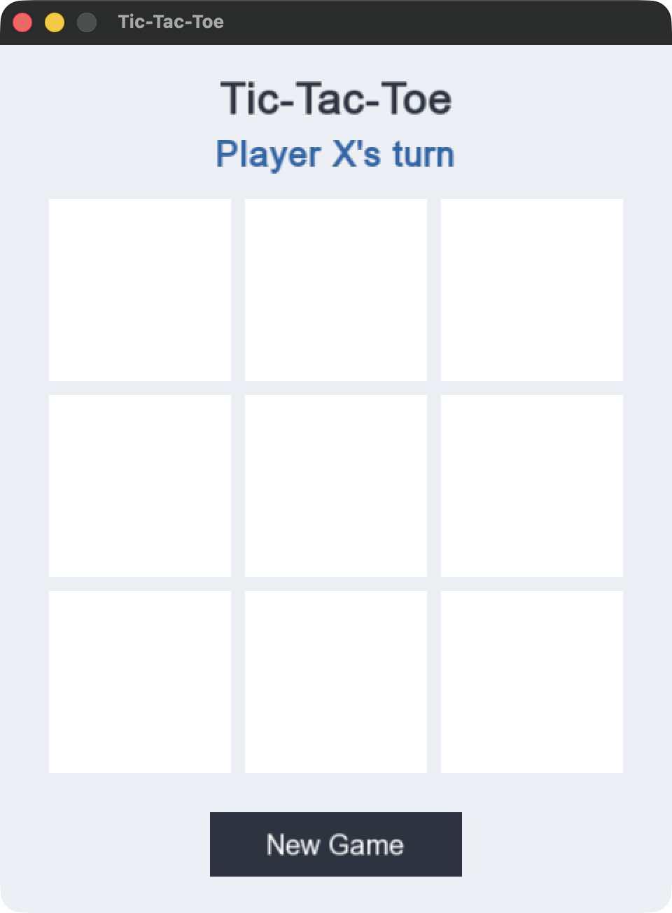

# Tic-Tac-Toe C++

A two-player Tic-Tac-Toe (XO) game written in C++. It started as a console game and was later upgraded with a graphical desktop version using SFML.

## Project Evolution

**Version 1 — Console application** (`console/`)

The original game. Players type a number from 1 to 9 to place their symbol, and the board is printed in the terminal. The messages are in German (for example `Aktueller Spieler` = current player, `Gewinner` = winner, `Unentschieden` = draw). This version is kept unchanged so the progression stays visible.

**Version 2 — Graphical desktop application** (`gui/`)

The same game in a real window. Players click on the board with the mouse instead of typing numbers. The win checking uses the same 8 lines (3 rows, 3 columns, 2 diagonals) as the console version.

## Features

- Two-player mode (X and O on the same computer)
- Win detection for rows, columns and diagonals
- Draw detection when the board is full
- Console version: input validation for out-of-range numbers, occupied fields and non-numeric input
- GUI version:
  - 3x3 board with clickable cells
  - Turn indicator ("Player X's turn" / "Player O's turn")
  - Win / draw message, with the winning line highlighted
  - Occupied cells cannot be selected
  - No more moves after the game is over
  - "New Game" button to restart

## Technologies

- C++17
- SFML 3 (graphics, window and mouse input)
- CMake

## GUI Version

The GUI code is split into two parts:

- `gui/game.h` / `gui/game.cpp` — the game logic (board, current player, making a move, checking for a winner or draw, resetting). It does not use SFML.
- `gui/main.cpp` — the SFML part: opens the window, draws the board, X and O symbols, status text and button, and turns mouse clicks into moves.

Every frame, the program handles events (mouse clicks, closing the window), then redraws everything. A click on a cell calls `makeMove()`, which ignores the click if the cell is already taken or the game is over. A click on "New Game" calls `resetGame()`.

## How to Build

Tested on macOS with Homebrew.

Install SFML and CMake:

```bash
brew install sfml cmake
```

Build both versions:

```bash
mkdir build
cd build
cmake ..
cmake --build .
```

Run the GUI version:

```bash
./xo-gui
```

Run the console version:

```bash
./xo-console
```

The console version has no dependencies and can also be compiled on its own:

```bash
g++ console/xo-game.cpp -o xo
./xo
```

## How to Play

- Player X always starts.
- **GUI:** click an empty cell to place your symbol. The text above the board shows whose turn it is. When someone wins or the board is full, the result is shown and the board is locked until you click **New Game**.
- **Console:** enter the number of a field:

```
1 | 2 | 3
4 | 5 | 6
7 | 8 | 9
```

## Testing

- The GUI game logic (`gui/game.cpp`) passed 19 automated tests during development: moves for X and O, rejecting occupied and out-of-range cells, all 3 horizontal, 3 vertical and 2 diagonal wins, a draw, a win on the 9th move, no moves after a win or draw, and restarting.
- The GUI application was built and launched successfully on macOS (screenshot below).
- Mouse interaction in the GUI was not tested automatically.

## Project Structure

```
xo-game-cpp/
├── console/
│   └── xo-game.cpp      # Version 1: console game
├── gui/
│   ├── game.h           # Game logic (declarations)
│   ├── game.cpp         # Game logic: moves, win/draw check, reset
│   └── main.cpp         # SFML window, drawing and mouse input
├── assets/
│   └── gui-screenshot.png
├── CMakeLists.txt
└── README.md
```

## What I Learned

- Separating game logic from the user interface, so the same rules work in the console and in a window
- The basics of SFML: windows, the event loop, drawing shapes and text, and mouse input
- Building a project with more than one source file and an external library using CMake
- Validating user input so the program does not break on unexpected input

## Screenshots / Demo

GUI version at start-up:


